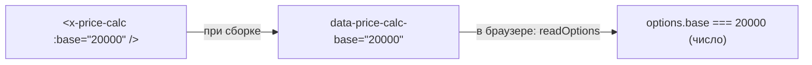

# 7. Компонент со своим JS: калькулятор стоимости

[starters/vanilla/src/components/price-calc/](../../starters/vanilla/src/components/price-calc/) —
четыре файла.

## Что это

Блок «Сколько стоит сайт?» на главной стартера: ползунок «страниц», флажки доп. услуг, сумма,
которая «досчитывает» до нового значения, и кнопка «Обсудить проект», открывающая модалку с уже
заполненным расчётом.

Это **образец компонента проекта**: разметка, стили, поведение и тест в одной папке. Новый
компонент со своим JS делайте по нему (`npm run new -- component имя --js` создаст такую же
заготовку).

## Что делает

- Считает сумму: база + страницы × цена страницы + выбранные опции.
- Показывает число страниц и сумму, анимируя её изменение.
- «Обсудить проект» ждёт модалку `#callback`, вписывает расчёт в скрытое поле заявки и открывает её.
- Сообщает в шину `price:change` и `price:order` — для аналитики и кого угодно ещё.
- Отдаёт наружу текущий расчёт: `api.value`.

## Файлы

```
price-calc/
├── price-calc.html     разметка: из props → data-атрибуты
├── price-calc.scss     стили (подключаются сами)
├── price-calc.js       поведение (запускается само)
└── price-calc.test.js  тест — заодно пример использования
```

## Разметка: props превращаются в настройки модуля

```html
<form class="price-calc" :data-price-calc-base="base ?? 15000" :data-price-calc-per-page="perPage ?? 4000">
  <label class="field">
    <span class="field__label">Страниц: <b data-calc-pages-out>5</b></span>
    <input class="price-calc__range" type="range" name="pages" min="1" max="30" value="5" data-calc-pages />
  </label>
  <fieldset class="price-calc__options">
    <legend class="field__label">Дополнительно</legend>
    <label x-for="option of options ?? calcOptions" class="checkbox">
      <input type="checkbox" name="extras" :value="option.price" :data-label="option.label" />
      <span>{{ option.label }} <span class="muted">+{{ option.price.toLocaleString('ru-RU') }} ₽</span></span>
    </label>
  </fieldset>
  <div class="price-calc__total">
    <output class="price-calc__sum" data-calc-total aria-live="polite">—</output>
    <x-button icon="arrow-right" data-calc-order>Обсудить проект</x-button>
  </div>
</form>
```

Как это связано:



Шаблон работает при сборке и не может передать значение в JS напрямую. Мост — **data-атрибут**:
шаблон пишет его, модуль читает через `readOptions`. Этот же атрибут можно задать и руками в
обычном HTML — модуль не заметит разницы.

Мелочи разметки:

- **`<form>`**, а не `<div>`: группа полей. `name` у полей позволяет найти отмеченные одним
  селектором `input[name="extras"]:checked`.
- **`<output aria-live="polite">`** — `<output>` по смыслу «результат вычисления»;
  `aria-live` — скринридер **сам прочитает** новую сумму, когда она изменится, дождавшись паузы
  в речи (`polite`).
- **`<fieldset>` + `<legend>`** — скринридер скажет «Дополнительно, группа» перед флажками.
- **`options ?? calcOptions`** — список опций можно передать props, иначе возьмётся
  `src/data/calc-options.json`.
- **`data-module` нигде нет** — его добавит плагин, потому что рядом есть `price-calc.js`.

## Поведение по частям

```js
import { createDisposer } from 'kit/js/core/lifecycle.js'
import { readOptions } from 'kit/js/core/options.js'
import { gsap } from '../../lib/gsap.js'

const DEFAULTS = {
  base: 15000,
  perPage: 4000,
}

const rub = (n) => `${n.toLocaleString('ru-RU')} ₽`
```

- GSAP — из `src/lib/gsap.js` проекта, а не из `'gsap'` (одно место плагинов и настроек).
- `toLocaleString('ru-RU')` — разряды неразрывными пробелами: `45 000`.

```js
export default function priceCalc(el, ctx = {}) {
  const options = readOptions(el, 'price-calc', DEFAULTS, ctx.options)
  const d = createDisposer()
  const pages = el.querySelector('[data-calc-pages]')
  const pagesOut = el.querySelector('[data-calc-pages-out]')
  const total = el.querySelector('[data-calc-total]')
```

Поиск элементов — по `data-calc-*`, а не по классам. Классы — для стилей и могут поменяться при
редизайне; `data-` атрибуты — «крючки» для JS, их никто не тронет случайно.

### Состояние — вычисляется, а не хранится

```js
function state() {
  const extras = Array.from(el.querySelectorAll('input[name="extras"]:checked'))
  const sum = options.base + Number(pages.value) * options.perPage + extras.reduce((s, i) => s + Number(i.value), 0)
  return { pages: Number(pages.value), extras: extras.map((i) => i.dataset.label), sum }
}
```

Сумма **не хранится в переменной** — она каждый раз считается из полей формы. Поля и есть
единственный источник правды. Хранили бы копию — пришлось бы следить, чтобы она не разошлась с
полями (например, после `form.reset()`).

`Number(i.value)` — значения полей всегда строки, `"3000" + 0` дал бы `"30000"`.

### Анимация «досчитывания»

```js
const shown = { value: 0 }
d.add(() => gsap.killTweensOf(shown))
const render = () => (total.textContent = rub(Math.round(shown.value)))

function update() {
  const s = state()
  pagesOut.textContent = String(s.pages)
  if (ctx.reduced || !shown.value) {
    shown.value = s.sum
    render()
  } else {
    gsap.to(shown, { value: s.sum, duration: 0.4, overwrite: true, onUpdate: render })
  }
  ctx.bus?.emit('price:change', s)
}
```

- GSAP умеет анимировать **любое число в объекте**, не только CSS. `shown.value` плавно едет к
  новой сумме, а `onUpdate` на каждом кадре пишет его в `<output>`.
- `overwrite: true` — двигаете ползунок быстро: каждая новая анимация отменяет предыдущую, а не
  спорит с ней.
- **Первый показ** (`!shown.value`) и «меньше движения» — сразу итог, без анимации. Иначе при
  загрузке страницы сумма «досчитывала» бы от нуля.
- `d.add(() => gsap.killTweensOf(shown))` — остановить анимацию при уборке.
- `ctx.bus?.emit` — `?.` на случай запуска без шины (тест, ручной вызов).

### События

```js
d.listen(el, 'input', update)
d.listen(el, 'submit', (event) => event.preventDefault())
```

- Одно событие `input` на всю форму — всплывает от ползунка и от флажков.
- `submit` отменяем: Enter в поле формы иначе **перезагрузил бы страницу** (форма без `action`
  отправляется на тот же адрес).

### Связь с модалкой

```js
d.listen(el, 'click', async (event) => {
  if (!event.target.closest('[data-calc-order]')) return
  const s = state()
  const dialog = await ctx.modules.when('#callback', 'dialog')
  const box = document.getElementById('callback')
  const comment = box.querySelector('input[name="comment"]')
  comment.value = `Калькулятор: ${s.pages} стр.${s.extras.length ? ', ' + s.extras.join(', ') : ''} — ${rub(s.sum)}`
  box.querySelector('[data-callback-note]').textContent =
    `Ваш расчёт: ${rub(s.sum)}. Оставьте телефон — обсудим детали.`
  dialog.open()
  ctx.bus?.emit('price:order', s)
})
```

- `when`, а не `get`: модуль модалки ленивый, на медленной сети его код мог ещё не приехать.
- Скрытое поле `comment` в форме модалки уйдёт на сервер вместе с заявкой — менеджер увидит, что
  человек насчитал.
- Подпись в модалке меняется на «Ваш расчёт: …» — человек видит, что расчёт не потерялся.
- `price:order` — «новость» для аналитики (плагин `02-analytics.js` превращает её в цель).

```js
  update()

  return {
    get value() { return state() },
    destroy: d.dispose,
  }
}
```

- `update()` в конце — первый расчёт при запуске.
- `get value()` — **геттер**: каждое чтение `api.value` возвращает свежий расчёт.

## Тест

```js
it('считает сумму из настроек, страниц и опций', () => {
  const el = html(markup) // base 10 000, per-page 1 000, 5 страниц
  const api = priceCalc(el, createCtx())
  expect(el.querySelector('[data-calc-total]').textContent).toBe(`${(15000).toLocaleString('ru-RU')} ₽`)
  el.querySelector('input[name="extras"]').click() // + SEO 3 000
  expect(api.value).toEqual({ pages: 5, extras: ['SEO'], sum: 18000 })
  api.destroy()
})
```

Ожидаемая строка собрана через `toLocaleString`, а не написана `'15 000 ₽'`: в строке
**неразрывный** пробел, и обычный пробел в тесте не совпал бы.

Второй тест подменяет `ctx.modules.when` и проверяет, что модалку попросили открыться, —
разобран в [главе 10](../learn/10-testing.md#подмена-соседей-vifn).

## Что будет, если…

| Убрать                                       | Что сломается                                              |
| -------------------------------------------- | ---------------------------------------------------------- |
| `!shown.value` в условии                     | при загрузке сумма «досчитывает» от нуля                   |
| `overwrite: true`                            | быстрое движение ползунка — анимации дерутся, цифры скачут |
| `preventDefault` на `submit`                 | Enter в форме перезагружает страницу                       |
| `await ctx.modules.when` → `ctx.modules.get` | на медленной сети первый клик падает с `undefined.open`    |
| `Number(...)` в `state`                      | сумма склеивается строкой: `"15000" + "4000"`              |

## Проверьте себя

1. Как поставить на странице калькулятор с базой 30 000 и своими опциями из `src/data/extras.json`?
2. Почему сумма не хранится в переменной модуля?
3. Что прочитает скринридер, когда сумма изменится?

<details>
<summary>Ответы</summary>

1. `<x-price-calc :base="30000" :options="extras" />` — `extras` возьмётся из
   `src/data/extras.json` (формат `[{ "label": "…", "price": 5000 }]`).
2. Поля формы — единственный источник правды. Копия могла бы разойтись с ними (сброс формы,
   автозаполнение браузера).
3. Новую сумму из `<output aria-live="polite">`, когда закончит текущую фразу. Анимация меняет
   текст много раз за 0,4 с — разные скринридеры могут зачитать и промежуточное число, а при «меньше движения»
   сумма меняется сразу, одним значением.

</details>
