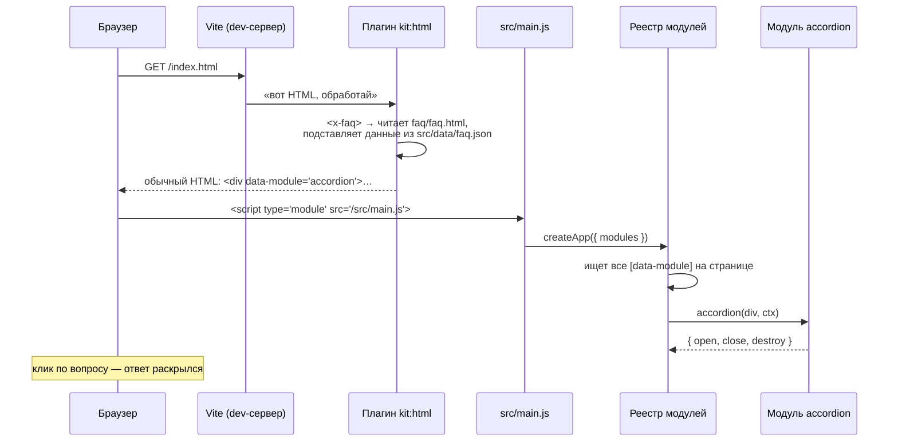

# 00. С чего начать

Этот учебник для человека, который знает HTML, CSS и немного JavaScript (переменные, функции,
`addEventListener`), но ещё не собирал сайт из «модулей» и не писал плагинов для Vite.
После него вы сможете открыть любой файл шаблона и понять, что он делает и зачем.

Справочник (все настройки всех модулей) лежит рядом, в [docs/](../README.md). Учебник —
это **объяснение**, справочник — **таблицы**. Начните с учебника.

## Как устроена каждая глава

1. **Зачем** — какую боль решает эта часть шаблона, на бытовом примере.
2. **Самый маленький пример** — 10–20 строк, которые можно понять целиком.
3. **Как это сделано в ките** — настоящий код с разбором по строкам.
4. **Ошибки** — что ломается у всех в первый раз.
5. **Попробуйте сами** — задания с ответами под спойлером.

Читайте с запущенным проектом: `npm run dev` в папке шаблона, рядом — код.

## Что такое frontend-kit одной фразой

**Папка с готовыми деталями сайта и команда, которая собирает из неё новый проект.**

Детали — это:

| Деталь                                         | Пример                              | Где лежит                          |
| ---------------------------------------------- | ----------------------------------- | ---------------------------------- |
| **Модуль** — поведение                         | аккордеон, модалка, слайдер         | `kit/js/modules/`                  |
| **Компонент** — кусок разметки                 | карточка, шапка, FAQ                | `starters/vanilla/src/components/` |
| **Стили** — настройки и миксины                | цвета, брейкпоинты, `container`     | `kit/scss/`                        |
| **Формы** — проверка полей                     | «телефон введён полностью»          | `kit/js/form/`                     |
| **Vite-плагины** — то, что работает при сборке | `<x-card>` → HTML, иконки → спрайт  | `kit/vite/`                        |
| **Dev-панель** — инструменты разработчика      | сетка, FPS, «что вылезает за экран» | `kit/devtools/`                    |

Команда `npm run create -- ../my-site --stack vanilla` копирует нужные детали в новую папку,
и получается **самостоятельный** проект. Шаблон ему больше не нужен.

## Картинка целиком: путь от HTML до ожившего аккордеона

Вы написали на странице:

```html
<x-faq :items="faq" />
```

и открыли `http://localhost:5173`. Что произошло по шагам:



Обратите внимание на **две половины**:

- **До браузера** (сервер, Node.js): плагин превращает `<x-faq>` в обычный HTML. В браузер не
  уходит ни строчки кода плагина — только готовая разметка. Глава 01.
- **В браузере**: `main.js` находит в разметке `data-module="accordion"` и запускает функцию
  `accordion()`. Главы 02 и 03.

Связывает их **один атрибут** — `data-module`. Плагин его пишет, реестр его читает.

## Словарь в одну строку

Вернитесь сюда, если встретили незнакомое слово.

| Слово                | Простыми словами                                                                | Пример в ките                                  |
| -------------------- | ------------------------------------------------------------------------------- | ---------------------------------------------- |
| **Модуль**           | Функция, которая «оживляет» блок разметки и умеет за собой убрать               | `accordion(el, ctx)`                           |
| **`init`**           | Сама эта функция: получает элемент, возвращает `{ destroy }`                    | `export default function accordion(root, ctx)` |
| **`destroy`**        | «Выключи всё, что включил»: снять обработчики, остановить анимации              | `return { destroy: d.dispose }`                |
| **Экземпляр**        | То, что вернула функция модуля — его можно дёргать снаружи                      | `{ open, close, destroy }`                     |
| **`data-module`**    | Атрибут «запусти на мне такой-то модуль»                                        | `<div data-module="accordion">`                |
| **Реестр**           | Словарь «имя модуля → функция»                                                  | `{ accordion, dialog, tabs, … }`               |
| **Ленивый модуль**   | Код скачивается, только если блок есть на странице                              | `lazy(() => import('./slider'))`               |
| **`ctx` (контекст)** | Общий «рюкзак», который получает каждый модуль                                  | `{ bus, modules, reduced, scroll }`            |
| **Шина (bus)**       | Доска объявлений: один пишет «случилось X», другие читают                       | `ctx.bus.emit('cart:add', item)`               |
| **Disposer**         | Копилка «как выключить» — всё, что включили, она потом выключит                 | `createDisposer()`                             |
| **Опции**            | Настройки модуля из `data-`атрибутов                                            | `data-accordion-multiple`                      |
| **Компонент**        | Папка с разметкой (+ стили, + JS), вызывается тегом `<x-имя>`                   | `<x-card>`                                     |
| **Prop**             | Значение, которое передали компоненту                                           | `<x-card title="Быстро">`                      |
| **Слот**             | Дырка в компоненте, куда вставляется содержимое из вызова                       | `<slot />`                                     |
| **Vite**             | Сервер разработки и сборщик: отдаёт файлы, обновляет страницу, собирает `dist/` | `npm run dev`                                  |
| **Плагин Vite**      | Функция, которая вмешивается в работу Vite                                      | `kit:html`, `kit:icons`                        |
| **SCSS**             | CSS с переменными, функциями и импортами; компилируется в CSS                   | `space(4)` → `16px`                            |
| **Схема**            | Описание правил формы одним объектом                                            | `s.object({ phone: s.string().phone() })`      |
| **Reduced motion**   | Настройка ОС «меньше анимаций»; кит её уважает                                  | `ctx.reduced === true`                         |
| **ScrollTrigger**    | Плагин GSAP: «запусти анимацию, когда блок доехал до места»                     | модули `reveal`, `parallax`                    |

## Как читать код кита

- **Комментарий в начале каждого файла** объясняет, зачем файл, как им пользоваться и какие
  баги в нём закрыты. Начинайте с него — часто дальше читать уже не нужно.
- **Тест рядом** (`*.test.js`) — это живой пример использования. Непонятно, как вызвать
  функцию, — откройте её тест.
- **Не нашли, где что-то делается?** Ищите по тексту, который видите в консоли или на экране:
  «нет модуля «acordion»» → `kit/js/core/registry.js`.

## Порядок чтения

| Глава                                             | О чём                                                         | Когда читать                      |
| ------------------------------------------------- | ------------------------------------------------------------- | --------------------------------- |
| [01. Страницы и компоненты](01-components.md)     | `<x-card>`, props, слоты, циклы, данные из JSON               | вы верстаете страницу             |
| [02. Модуль с нуля](02-module.md)                 | `init → destroy`, уборка, опции                               | нужно поведение на блоке          |
| [03. Как data-module находит код](03-registry.md) | реестр, ленивые модули, подгружаемый контент                  | любопытно, «как оно само»         |
| [04. Модули разговаривают](04-communication.md)   | шина событий, `ctx.modules`, DOM-события                      | один блок должен влиять на другой |
| [05. Формы](05-forms.md)                          | схемы, когда показывать ошибки, маски, ошибки сервера         | на странице есть форма            |
| [06. Стили](06-styles.md)                         | SCSS: настройки, функции, брейкпоинты, тёмная тема            | меняете «лицо» проекта            |
| [07. Анимации](07-animations.md)                  | GSAP, ScrollTrigger, reduced motion, почему «прыгает»         | делаете эффекты                   |
| [08. Кит в React](08-react.md)                    | `useModule`, StrictMode, `KitProvider`                        | проект на React                   |
| [09. Сборка и плагины Vite](09-vite.md)           | как `<x-card>` становится HTML, мок-API, спрайт, защита прода | хотите понять «магию»             |
| [10. Тесты](10-testing.md)                        | Vitest + jsdom, как тестировать модуль                        | пишете свой модуль                |
| [Разбор кода](../code/README.md)                  | файл за файлом: что делает каждая строка                      | разбираете конкретный файл        |
| [Практикум](labs.md)                              | задания на живом коде шаблона                                 | хотите руками                     |

Если времени мало — прочитайте **00 → 02 → 03 → 04**. Это сердце кита; остальное —
применения тех же идей.
