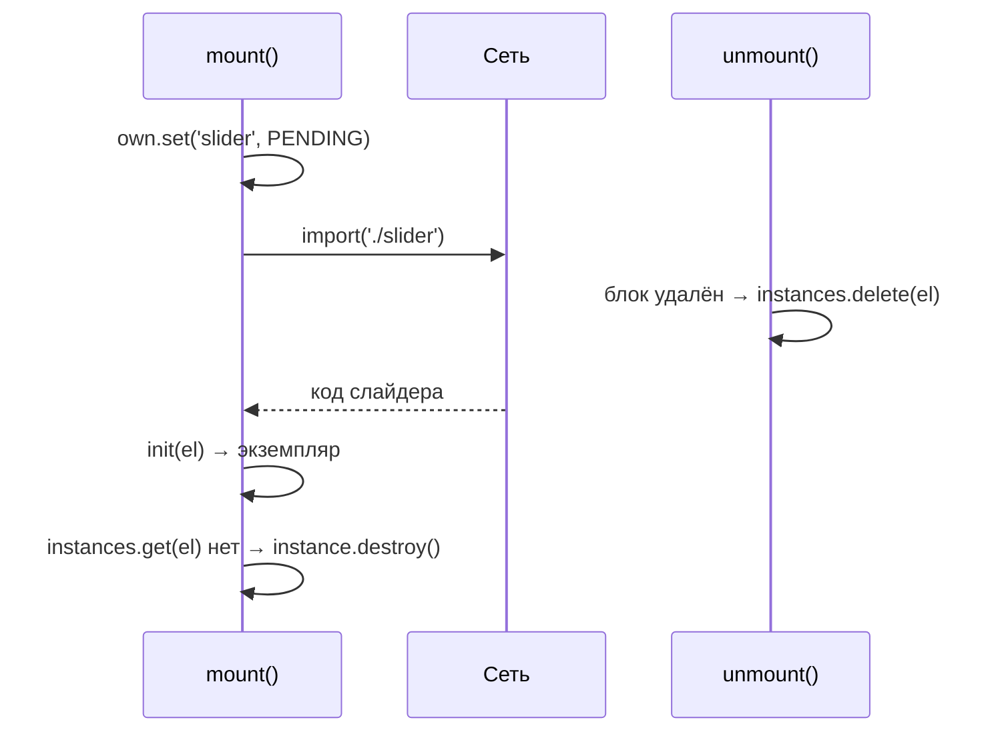

# 03. Как `data-module` находит код

В главе 02 мы написали функцию модуля и атрибут `data-module="copy"`. Но кто вызывает
функцию? Эта глава — про **реестр**: 150 строк в
[kit/js/core/registry.js](../../kit/js/core/registry.js), на которых держится весь кит.

## Зачем

Представим наивную версию:

```js
import accordion from './accordion.js'
import dialog from './dialog.js'
import slider from './slider.js' // 40 КБ кода + библиотека Swiper

document.querySelectorAll('.accordion').forEach((el) => accordion(el))
document.querySelectorAll('dialog').forEach((el) => dialog(el))
document.querySelectorAll('.slider').forEach((el) => slider(el))
```

Что с ней не так:

1. **Слайдер скачивается на каждой странице**, даже где его нет.
2. **Новые блоки не оживают.** «Показать ещё» добавило карточки — для них никто не вызвал функцию.
3. **Повторный запуск.** Кто-то вызвал этот код ещё раз — у аккордеона два обработчика клика:
   клик открывает и тут же закрывает.
4. **Одна ошибка ломает всё.** Упал слайдер — диалоги ниже по коду не запустились.
5. **Опечатка молчит.** `data-module="acordion"` — ничего не происходит, ничего не пишется.

Реестр решает все пять.

## Самый маленький реестр

Сначала — как это могло бы выглядеть в 15 строках, чтобы понять идею:

```js
const registry = {
  accordion: (el) => {
    /* … */
  },
  copy: (el) => {
    /* … */
  },
}

function mount(root = document) {
  for (const el of root.querySelectorAll('[data-module]')) {
    const name = el.dataset.module // "accordion"
    const init = registry[name] // функция модуля
    if (!init) {
      console.warn(`нет модуля «${name}»`) // проблема 5 решена
      continue
    }
    init(el)
  }
}

mount()
```

`el.dataset.module` — это значение атрибута `data-module`. Браузер раскладывает все `data-*`
атрибуты в объект `dataset`: `data-module` → `dataset.module`, `data-accordion-multiple` →
`dataset.accordionMultiple`.

Теперь добавим по одному решению.

## Решение 1: не запускать дважды — `WeakMap`

Нужно помнить, на каких элементах модуль уже запущен. Кит хранит это так:

```js
const instances = new WeakMap() // элемент → Map(имя модуля → экземпляр)
```

```js
for (const name of moduleNames(el)) {
  if (instances.get(el)?.has(name)) continue    // уже запущен — пропускаем
  …
}
```

**Почему `WeakMap`, а не обычный `Map`?** Обычный `Map` держит элемент «за руку»: блок удалили
из страницы, а `Map` всё ещё хранит ссылку, и память не освобождается. `WeakMap` держит слабо:
элемент удалили и забыли — сборщик мусора уберёт и запись. Утечки памяти нет без всякой уборки.

## Решение 2: несколько модулей на одном элементе

```html
<a class="btn" data-module="magnetic tooltip">…</a>
```

```js
export const moduleNames = (el) => (el.dataset.module ?? '').trim().split(/\s+/).filter(Boolean)
// "magnetic  tooltip" → ['magnetic', 'tooltip']
```

Поэтому внутри `instances` для каждого элемента — `Map` «имя → экземпляр», а не один экземпляр.

## Решение 3: ошибка одного не ломает других

```js
try {
  const instance = await init(el, ctx)
  own.set(name, instance ?? null)
} catch (error) {
  own.delete(name)
  console.error(`[kit] модуль «${name}» упал при запуске`, el, error)
}
```

Упал слайдер — в консоли понятная ошибка **с элементом** (по нему можно кликнуть в DevTools), а
остальные модули запустились.

## Решение 4: ленивая загрузка — `lazy()`

```js
const registry = {
  accordion, // маленький — в общем файле
  slider: lazy(() => import('./modules/slider')), // большой — отдельным файлом
}
```

`import('./modules/slider')` — **динамический импорт**: Vite при сборке положит слайдер в
отдельный файл, и браузер скачает его, только когда этот код выполнится. А выполнится он,
только если на странице нашёлся `data-module="slider"`.

Как устроен `lazy`:

```js
export function lazy(loader) {
  let promise = null
  const load = () => {
    promise ??= loader().then((mod) => mod.default ?? mod.init ?? mod)
    return promise
  }
  return Object.assign(
    async (el, ctx) => (await load())(el, ctx), // выглядит как обычная функция модуля
    { [LAZY]: true }, // плюс метка «я ленивый»
  )
}
```

Разбор:

- `lazy` возвращает **обычную функцию модуля** `(el, ctx) => …`. Реестру не нужно знать, ленивый
  модуль или нет: он просто вызывает функцию.
- `promise ??= …` — «если ещё не грузили, начни». Десять слайдеров на странице → **один**
  сетевой запрос: все десять ждут одно и то же обещание.
- `mod.default ?? mod.init ?? mod` — файл может экспортировать модуль как `default` или как `init`.

В стартере ленивыми делаются **все** модули проекта — одной строкой:

```js
const projectModules = modulesFromGlob(import.meta.glob(['./modules/*/index.js']))
```

`import.meta.glob` — возможность Vite: «найди все файлы по маске и дай мне объект
`путь → функция-загрузчик`». `modulesFromGlob` превращает путь в имя и оборачивает в `lazy`:

```
./modules/copy/index.js           →  copy: lazy(() => import('./modules/copy/index.js'))
./components/price-calc/price-calc.js  →  'price-calc': lazy(…)
```

Вот почему новый модуль не нужно дописывать в реестр: положили папку — маска её нашла.

## Решение 5: подгруженный контент — `MutationObserver`

```js
export function observe(registry, ctx, root = document.body) {
  const observer = new MutationObserver((records) => {
    for (const record of records) {
      record.removedNodes.forEach((node) => {
        if (node instanceof Element && !node.isConnected) unmount(node)
      })
      record.addedNodes.forEach((node) => {
        if (node instanceof Element) mount(registry, ctx, node)
      })
    }
  })
  observer.observe(root, { childList: true, subtree: true })
  return () => observer.disconnect()
}
```

`MutationObserver` — встроенный в браузер «наблюдатель»: зовёт функцию, когда в DOM что-то
добавили или удалили. Кит использует его так:

- **добавили узел** → `mount` внутри него: новые карточки ожили сами;
- **удалили узел** → `unmount`: вызвать `destroy` у всех модулей внутри.

Тонкость: `!node.isConnected`. Если элемент не удалили, а **переставили**
(`list.appendChild(card)` переносит существующую карточку в конец), наблюдатель сообщит
«удалён» и сразу «добавлен». Но в момент обработки элемент уже снова в документе
(`isConnected === true`) — останавливать его нельзя.

## Решение 6: гонка с ленивым модулем — заглушка `PENDING`

Это самое хитрое место. Посмотрите:

```js
own.set(name, PENDING) // 1. сразу занять место
jobs.push(
  (async () => {
    const instance = await init(el, ctx) // 2. ждём загрузку (сеть!)
    if (!instances.get(el)?.has(name)) return instance?.destroy?.() // 3. а нас не удалили?
    own.set(name, instance ?? null) // 4. место занято настоящим экземпляром
  })(),
)
```

Две гонки, которые здесь закрыты:

**Гонка А: двойной запуск во время загрузки.** Ленивый слайдер грузится 300 мс. За это время
`mount` вызвали ещё раз (подгрузился соседний блок, и наблюдатель запустил `mount` для
родителя). Если бы место занималось только **после** `await`, второй вызов не увидел бы
запущенного слайдера и запустил бы его ещё раз. Заглушка `PENDING` ставится **до** `await` —
второй вызов видит «занято».

**Гонка Б: блок удалили, пока модуль грузился.** Пользователь ушёл со страницы (SPA), блок
удалён, `unmount` удалил запись из `instances`. А через 200 мс модуль догрузился и запустился —
на мёртвом элементе. Шаг 3 проверяет: записи нет — значит, нас уже убрали; сразу вызываем
`destroy` у только что созданного экземпляра.



## Целиком: что делает `createApp`

[kit/js/core/app.js](../../kit/js/core/app.js) собирает всё вместе. По шагам:

```js
export async function createApp({ modules = {}, plugins = [], smooth = true, watch = true } = {}) {
  document.documentElement.classList.add('js')                 // 1
  const scroll = createSmoothScroll({ … })                      // 2
  const ctx = { bus: createBus(), scroll, reduced, breakpoints, modules: modulesApi }  // 3
  for (const plugin of plugins) d.add(await plugin({ ctx, modules: modulesApi }))     // 4
  const result = await mount(modules, ctx, root)                // 5
  ScrollTrigger.sort(); ScrollTrigger.refresh()                 // 6
  if (watch) d.add(observe(modules, ctx, document.body, { strict: false }))  // 7
  // 8. пересчёт ScrollTrigger при изменении высоты страницы
  html.classList.add('is-ready')                                // 9
  ctx.bus.emit('app:ready', result)
}
```

| Шаг                             | Зачем                                                                                                              |
| ------------------------------- | ------------------------------------------------------------------------------------------------------------------ |
| 1. класс `js` на `<html>`       | CSS прячет элементы до анимации появления **только если JS работает**. Без JS (или если скрипт упал) контент виден |
| 2. плавный скролл               | Lenis, кроме тач-устройств и «меньше анимаций»                                                                     |
| 3. `ctx`                        | общий «рюкзак», который получит каждый модуль (глава 04)                                                           |
| 4. плагины                      | код на весь сайт (аналитика, настройки GSAP) — **до** модулей, чтобы модули могли им пользоваться                  |
| 5. `mount`                      | запустить все `data-module`                                                                                        |
| 6. `ScrollTrigger.sort/refresh` | модули запустились в случайном порядке — упорядочить анимации по странице (глава 07)                               |
| 7. `observe`                    | следить за подгружаемым контентом. `strict: false` — не ругаться на чужие модули                                   |
| 8. `ResizeObserver` на `body`   | догрузились картинки — высота страницы изменилась — пересчитать места запуска анимаций                             |
| 9. `is-ready` и `app:ready`     | «всё запущено» — для CSS и для кода, который ждёт старта                                                           |

## Ошибки

> **`[kit] нет модуля «acordion». Доступны: …`** — опечатка. Список доступных имён в той же
> строке.
>
> **Модуль запустился дважды** — значит, его запустили **не через реестр** (руками
> `accordion(el)` и ещё раз через `data-module`). Реестр не видит ручных вызовов.
>
> **Подгруженный блок не ожил** — его вставили до запуска приложения, или `watch: false`. Вызовите
> `app.mount(node)` вручную.
>
> **Удалили блок — модуль продолжает работать** (таймер, анимация) — значит, `destroy` убрал не
> всё. Проверьте, всё ли прошло через `createDisposer`.

## Попробуйте сами

1. Откройте DevTools → Network, фильтр JS. Откройте `index.html`, затем `ui-kit.html`. Какие
   файлы модулей скачались на второй странице, но не на первой? Почему?
2. В консоли на странице с FAQ выполните:
   ```js
   const faq = document.querySelector('.accordion')
   faq.remove()
   ```
   Что вызовет реестр и почему ему никто не сказал об удалении?
3. Почему `mount` возвращает `Promise`, хотя большинство модулей синхронные?
4. Напишите `data-module="accordion acordion"`. Что будет в консоли и запустится ли аккордеон?

<details>
<summary>Ответы</summary>

1. Модули, чьи блоки есть только на `ui-kit.html` (слайдер, выбор файлов, маски…). Они
   ленивые: код скачивается при первом блоке на странице.
2. `unmount(faq)` → `destroy` аккордеона. Об удалении сообщил `MutationObserver` из `observe`.
3. Ленивые модули грузятся по сети; `mount` ждёт **все** (`Promise.all`), чтобы вернуть
   итог `{ mounted, failed }` и чтобы `createApp` пересчитал анимации после запуска всех.
4. Предупреждение «нет модуля «acordion»», а `accordion` запустится: имена обрабатываются
   по отдельности, и ошибка одного не мешает другому.

</details>
