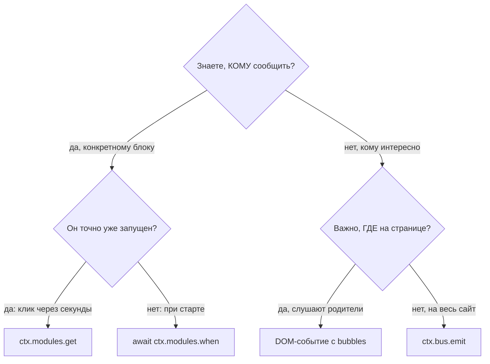

# 04. Модули разговаривают

## Зачем

Калькулятор стоимости посчитал сумму. Теперь:

- кнопка «Обсудить» должна **открыть модалку** заявки (это другой модуль — `dialog`);
- аналитика хочет знать, что человек **посчитал** (это плагин, не модуль вовсе);
- шапка, может быть, покажет «ваш расчёт: 45 000 ₽» (а может, и нет — на другом сайте шапки нет).

Модули не импортируют друг друга (тогда модалка тянула бы калькулятор на каждую страницу). Кит
даёт **три способа** связи, и у каждого своя ситуация.

| Способ                                                | Аналогия                       | Когда                                                          |
| ----------------------------------------------------- | ------------------------------ | -------------------------------------------------------------- |
| **`ctx.modules`** — достать экземпляр и вызвать метод | позвонить конкретному человеку | вы **знаете**, кому и что нужно: «модалка #callback, откройся» |
| **`ctx.bus`** — шина событий                          | объявление на доске в подъезде | вы **не знаете**, кому это интересно: «посчитали сумму»        |
| **DOM-событие** на элементе                           | крикнуть в комнате             | интересно тем, кто **рядом** в разметке (родитель, обёртка)    |

## Способ 1: `ctx.modules` — вызвать другой модуль

### Самый маленький пример

```html
<button data-module="open-faq">Открыть третий вопрос</button>
<div id="faq" class="accordion" data-module="accordion">…</div>
```

```js
export default function openFaq(el, ctx) {
  const d = createDisposer()
  d.listen(el, 'click', () => {
    const faq = ctx.modules.get('#faq') // экземпляр аккордеона: { open, close, … }
    faq.open(2)
  })
  return { destroy: d.dispose }
}
```

`ctx.modules.get('#faq')` возвращает **то, что вернула функция аккордеона** — объект с
`open`, `close`, `toggle`. Поэтому в главе 02 мы возвращали свои методы.

### Ловушка: модуль ещё не запущен

`get` сработал, потому что клик случился **через секунды** после загрузки — аккордеон давно
запущен. А если нужно вызвать другой модуль **при старте**?

```js
export default function openFaq(el, ctx) {
  ctx.modules.get('#faq').open(2) // 💥 undefined.open — аккордеон ещё грузится
}
```

Аккордеон — ленивый модуль (глава 03): его код ещё едет по сети. Порядок запуска модулей **не
гарантирован**. Для этого есть `when`:

```js
export default async function openFaq(el, ctx) {
  const faq = await ctx.modules.when('#faq', 'accordion') // ждём, пока запустится
  faq.open(2)
}
```

`when` возвращает обещание: если модуль уже запущен — сразу, если нет — когда запустится. Если
не запустится за 10 секунд — ошибка с понятным текстом «не дождались запуска: accordion на #faq.
Есть ли он на странице?».

Полный список:

| Вызов                         | Что вернёт                                                   |
| ----------------------------- | ------------------------------------------------------------ |
| `get('#faq')`                 | экземпляр единственного модуля на элементе (или `undefined`) |
| `get('#callback', 'dialog')`  | конкретный модуль, если на элементе их несколько             |
| `all('accordion')`            | все запущенные аккордеоны страницы                           |
| `first('cart')`               | первый запущенный `cart`                                     |
| `await when('#cart', 'cart')` | дождаться запуска на конкретном элементе                     |
| `await whenAny('cart')`       | дождаться первого `cart` где угодно                          |

### Как это сделано в ките: калькулятор открывает модалку

[price-calc.js](../../starters/vanilla/src/components/price-calc/price-calc.js):

```js
d.listen(el, 'click', async (event) => {
  if (!event.target.closest('[data-calc-order]')) return // клик не по «Обсудить» — мимо
  const s = state() // { pages, extras, sum }
  const dialog = await ctx.modules.when('#callback', 'dialog') // модалка ленивая — ждём
  const box = document.getElementById('callback')
  box.querySelector('input[name="comment"]').value = `Калькулятор: ${s.pages} стр. — ${rub(s.sum)}` // заполнили скрытое поле заявки
  dialog.open() // открыли
  ctx.bus?.emit('price:order', s) // и сообщили «всем» (способ 2)
})
```

Почему `when`, а не `get`, если это клик? Модалка ленивая и грузится, только когда… её блок
есть на странице. Он есть, но код мог ещё не доехать на медленном 3G, а человек уже кликнул.
`when` — это надёжно в обоих случаях.

## Способ 2: шина событий `ctx.bus`

### Самый маленький пример

```js
// модуль-калькулятор: сообщает, не зная, кто слушает
ctx.bus.emit('price:change', { sum: 45000 })

// любой другой модуль или плагин: слушает, не зная, кто шлёт
const off = ctx.bus.on('price:change', (data) => {
  console.log('Посчитали', data.sum)
})
d.add(off) // ← отписаться при уборке!
```

Шина — это словарь «имя события → список функций»:

```js
export function createBus() {
  const handlers = new Map() // 'price:change' → Set(функций)
  const last = new Map() // 'price:change' → последнее значение

  return {
    on(event, fn, { replay = false } = {}) {
      if (!handlers.has(event)) handlers.set(event, new Set())
      handlers.get(event).add(fn)
      if (replay && last.has(event)) fn(last.get(event)) // см. ниже
      return () => handlers.get(event)?.delete(fn) // функция «отписаться»
    },
    emit(event, payload) {
      last.set(event, payload)
      Array.from(handlers.get(event) ?? []).forEach((fn) => {
        try {
          fn(payload)
        } catch (error) {
          console.error(`[kit] bus «${event}»`, error)
        }
      })
    },
  }
}
```

Три детали, которые легко упустить:

1. **`on` возвращает функцию отписки.** Положите её в копилку `d.add(off)`. Иначе модуль удалили,
   а его обработчик всё ещё вызывается на каждое событие — и обращается к удалённым элементам.
2. **`Array.from(…)` перед `forEach`** — копия списка. Если обработчик внутри себя отпишется,
   исходный `Set` поменяется во время обхода, и следующий обработчик может пропуститься.
3. **`try/catch` вокруг каждого** — упал один подписчик, остальные всё равно получили событие.

### `replay`: «я опоздал, расскажите, что было»

Шапка запустилась **позже**, чем калькулятор отправил первую сумму (порядок не гарантирован!).
Обычная подписка пропустит это событие. С `replay: true` подписчик **сразу** получает последнее
значение:

```js
ctx.bus.on('price:change', (s) => (badge.textContent = rub(s.sum)), { replay: true })
```

Похоже на `BehaviorSubject` из RxJS, если встречали.

### Как это сделано в ките: аналитика без правки модулей

Плагин из `src/plugins/` получает тот же `ctx`. Упрощённо:

```js
// src/plugins/02-analytics.js
const GOALS = {
  'price:order': 'calc-order', // событие шины → имя цели в Метрике
  'copy-link:copied': 'copy-link',
}

export default function analytics({ ctx }) {
  const reach = (goal, params) => {
    if (!hasConsent('analytics')) return // нет согласия на cookies — молчим
    window.ym?.(COUNTER_ID, 'reachGoal', goal, params) // счётчик ещё не загружен — тоже молчим
  }
  const offs = Object.entries(GOALS).map(([event, goal]) => ctx.bus.on(event, (payload) => reach(goal, payload)))
  return () => offs.forEach((off) => off()) // уборка плагина
}
```

В разработке, пока счётчика нет, плагин пишет цели в консоль — видно, что события доходят.

Калькулятор не знает про Яндекс Метрику. Метрика не знает, как устроен калькулятор. Договорённость
одна — **имя события и форма данных**. Поэтому:

> Именуйте события «область:что случилось» (`price:change`, `dialog:open`) и ведите их список в
> README проекта. Через месяц иначе никто не вспомнит, кто что шлёт.

## Способ 3: DOM-события

Аккордеон при каждом раскрытии делает:

```js
root.dispatchEvent(
  new CustomEvent('accordion:toggle', {
    bubbles: true, // всплывает вверх по DOM, как click
    detail: { index, open, item }, // данные события
  }),
)
```

Слушать можно на нём самом или на любом родителе:

```js
document.querySelector('#faq').addEventListener('accordion:toggle', (event) => {
  console.log('Вопрос', event.detail.index, event.detail.open ? 'открыт' : 'закрыт')
})
```

Чем это отличается от шины? Событие привязано **к месту на странице**. Два аккордеона — два
разных источника; родитель слушает только своих детей. А шина — одна на весь сайт. Модули кита
шлют DOM-события (`dialog:open`, `form:success`, `tabs:change`…), потому что их удобно слушать
и без кита: из jQuery, из кода CMS, из React.

## Как выбрать



## Ошибки

> **`Cannot read properties of undefined (reading 'open')`** — `get` вызван до запуска модуля.
> Используйте `await when(…)`.
>
> **«на #x несколько модулей (reveal, dialog) — укажите имя»** — на элементе больше одного
> модуля. `get('#x', 'dialog')`.
>
> **Обработчик шины вызывается после удаления блока** — забыли `d.add(off)`.
>
> **Подписчик не получил событие** — подписался позже, чем его отправили. `{ replay: true }`.
>
> **Модуль импортирует другой модуль** (`import dialog from '../dialog'`) — теперь код модалки
> едет на каждую страницу с калькулятором, а модалка на странице — **второй** экземпляр, не тот,
> что запустил реестр. Берите через `ctx.modules`.

## Попробуйте сами

1. В консоли на главной стартера выполните:
   ```js
   __kit.ctx.bus.on('price:change', (s) => console.log(s))
   ```
   и подвигайте ползунок калькулятора. Что приходит?
2. Выполните `__kit.ctx.bus.last('price:change')`. Откуда шина знает значение?
3. Напишите плагин, который пишет в консоль номер каждого раскрытого вопроса FAQ. Шину или
   DOM-событие выберете? Почему?
4. Почему калькулятор и шлёт `price:order` в шину, и вызывает `dialog.open()` напрямую, а не
   что-то одно?

<details>
<summary>Ответы</summary>

1. `{ pages, extras, sum }` на каждое движение.
2. `emit` сохраняет последнее значение каждого события в `last` — для `replay`.
3. DOM-событие: аккордеон шлёт `accordion:toggle` на элементе, в шину он ничего не пишет.
   ```js
   // src/plugins/faq-log.js
   export default function faqLog() {
     const onToggle = (e) => e.detail.open && console.log('Открыт вопрос', e.detail.index)
     document.addEventListener('accordion:toggle', onToggle)
     return () => document.removeEventListener('accordion:toggle', onToggle)
   }
   ```
4. Открыть модалку — **конкретное действие** с известным получателем (способ 1). А «заказали
   расчёт» — **новость** для всех, кому интересно, их может быть ноль или пять (способ 2).

</details>
