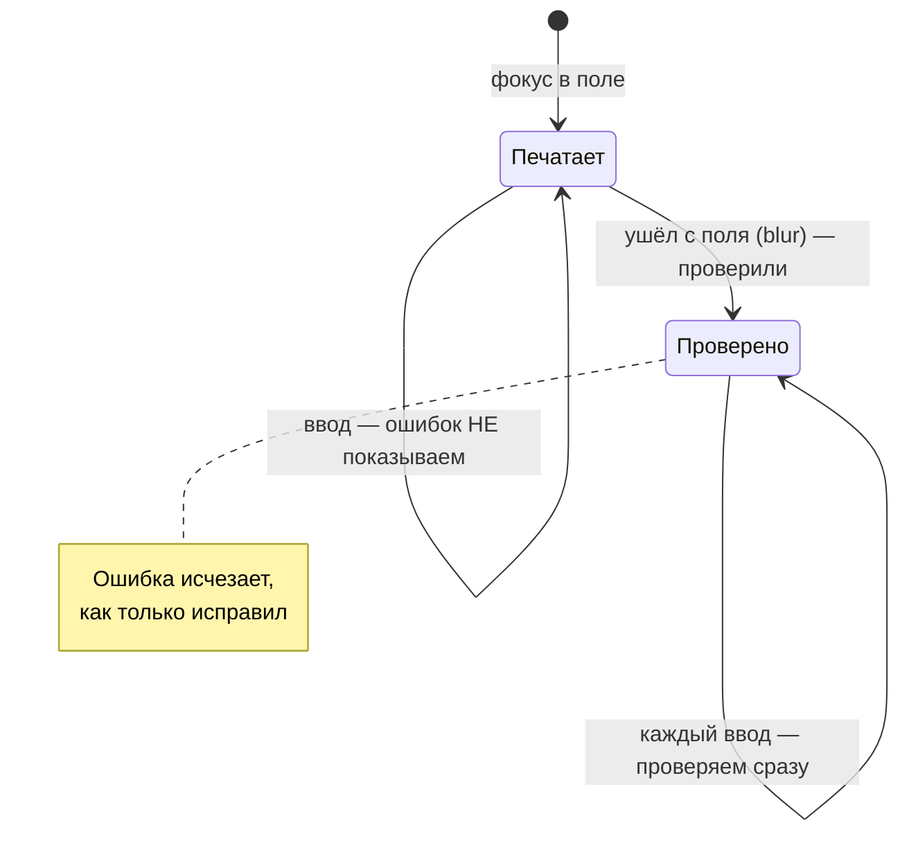

# 05. Формы — с нуля

## Зачем

Форма «Перезвоните мне» на первый взгляд — два поля и кнопка. На деле у неё десяток
обязанностей:

1. проверить, что имя не пустое, а телефон введён **полностью**;
2. показать ошибку **под полем**, а не алертом;
3. не ругаться, пока человек ещё печатает, но убрать ошибку **сразу**, как он её исправил;
4. помочь ввести телефон: `+7 (912) 345-67-89` — скобки и дефисы сами;
5. отправить без перезагрузки страницы;
6. не дать отправить дважды двойным кликом;
7. показать ошибку **сервера** («этот номер уже в базе») под нужным полем;
8. сообщить скринридеру, что в поле ошибка;
9. отсечь спам-ботов без капчи.

Модуль `form` кита делает всё это. Ваша часть — **правила** (схема) и **разметка**.

## Самый маленький пример

**Разметка** — обычная форма с `data-module="form"`:

```html
<form data-module="form" data-form-ajax data-form-schema="callback" action="/api/callback" method="post" novalidate>
  <label class="field">
    <span class="field__label">Имя</span>
    <input class="field__input" name="name" />
  </label>
  <label class="field">
    <span class="field__label">Телефон</span>
    <input class="field__input" name="phone" type="tel" data-mask="phone" />
  </label>
  <button class="btn" type="submit">Отправить</button>
  <p data-form-status role="status"></p>
</form>
```

**Правила** — схема в `src/forms/schemas.js`:

```js
import { registerSchema, s } from 'kit/js/form/index.js'

registerSchema(
  'callback',
  s.object({
    name: s.string().trim().min(2, 'Как к вам обращаться? Минимум 2 буквы'),
    phone: s.string().phone(),
  }),
)
```

Всё. Нажмите «Отправить» с пустыми полями — под полями появятся ошибки. Заполните — форма
уйдёт на `/api/callback`, и в `<p data-form-status>` появится «Спасибо».

Как они связаны: `data-form-schema="callback"` → модуль ищет схему, зарегистрированную под
именем `'callback'`.

## Часть 1. Схема: правила одним объектом

### Цепочка правил

```js
s.string().trim().min(2, 'Минимум 2 буквы')
```

Читается слева направо: «строка → убери пробелы по краям → не короче 2 символов, иначе такой
текст». Каждый метод возвращает **новую** схему — поэтому общую часть можно вынести:

```js
const phone = s.string().phone() // один раз
const callback = s.object({ phone }) // и переиспользовать
const order = s.object({ phone, address: s.string() })
```

### Все поля обязательны, пока не сказано иное

```js
s.string() // пусто → «Заполните поле»
s.string().optional() // пусто → ок; заполнено → проверяется как обычно
s.string().default('—') // пусто → значение '—'
```

«Пусто» — это `''`, строка из одних пробелов, `undefined`, `null` и пустой массив.

### Из поля всегда приходит строка

`<input>` отдаёт `"25"`, а не `25`. Схемы кита приводят типы сами (как `z.coerce` в zod):

| Схема         | Из поля пришло                    | После проверки                                     |
| ------------- | --------------------------------- | -------------------------------------------------- |
| `s.number()`  | `"1 500,5"`                       | `1500.5` — пробелы убраны, запятая стала точкой    |
| `s.number()`  | `"abc"`                           | ошибка «Введите число»                             |
| `s.boolean()` | `"on"` (отмеченный чекбокс)       | `true`                                             |
| `s.date()`    | `"31.12.2025"` или `"2025-12-31"` | `Date`                                             |
| `s.date()`    | `"31.02.2025"`                    | ошибка: JS «исправил» бы на 3 марта, а схема — нет |

### Правило на несколько полей

«Пароли совпадают» смотрит на **два** поля. Два способа:

```js
// 1. Готовый метод на поле
confirm: (s.string().equals('password', 'Пароли не совпадают'),
  // 2. Общее правило на весь объект — с указанием, под каким полем показать
  s
    .object({ contact: s.enum(['phone', 'email']), email: s.string().email().optional() })
    .refine((d) => d.contact !== 'email' || Boolean(d.email), {
      path: 'email', // ← под этим полем
      message: 'Укажите e-mail для связи',
    }))
```

### Результат проверки

```js
const result = schema.safeParse({ name: 'А', phone: '+7 (912' })
// {
//   success: false,
//   data: {},
//   errors: { name: 'Минимум 2 буквы', phone: 'Введите номер полностью' }
// }
```

`errors` — плоский объект «поле → **первая** ошибка». Именно это и нужно форме: под полем
показывается одна строка.

### Почему не zod?

Можно и zod — модуль примет любую схему с методом `safeParse`. Своя схема в ките, потому что
формам на лендингах незачем тянуть отдельную библиотеку ради трёх полей, а ещё им нужны вещи,
которых в zod нет из коробки: ИНН и СНИЛС с контрольными суммами, русские тексты, телефон под
маску, файлы с размером и типом.

## Часть 2. Когда показывать ошибки

Самый частый недочёт форм — ошибка появляется, **пока человек печатает**: ввёл первую букву
e-mail — «Неверный e-mail». Раздражает.

Модуль по умолчанию работает в режиме `onTouched` (как в react-hook-form):



| Момент                | Что видит человек                                      |
| --------------------- | ------------------------------------------------------ |
| печатает впервые      | ничего: ещё не закончил                                |
| ушёл с поля с ошибкой | ошибка под полем                                       |
| исправляет            | ошибка исчезает **на ту букву**, которая всё исправила |
| нажал «Отправить»     | все ошибки сразу, фокус на первое неверное поле        |

Другие режимы — `data-form-mode="onBlur | onChange | onSubmit | all"`.

### Как это устроено внутри

Модуль помнит два факта: какие поля человек уже **покидал** (`touched`) и была ли **попытка
отправки** (`submitted`):

```js
const shouldValidateOnChange = (key) =>
  submitted || // после попытки отправки — всегда
  options.mode === 'onChange' ||
  options.mode === 'all' ||
  (options.mode === 'onTouched' && touched.has(key)) // уже уходил с этого поля
```

И одна хитрость, которую легко пропустить: «Пароли не совпадают» висит под **вторым** полем.
Человек исправил **первое**. Ошибка должна исчезнуть, хотя второе поле не трогали. Поэтому на
каждый ввод модуль перепроверяет **все поля, на которых сейчас есть ошибка**:

```js
Object.keys(errors)
  .filter((other) => other !== key && other !== '_')
  .forEach(validateKey)
```

## Часть 3. Как ошибка попадает под поле

Модуль ищет обёртку поля (`[data-field]`, `fieldset` для группы, `.field` или просто родитель)
и создаёт в ней `<p class="field__error">`. Затем связывает поле и текст:

```html
<label class="field is-invalid">
  <span class="field__label">Телефон</span>
  <input name="phone" id="field-3" aria-invalid="true" aria-describedby="field-3-error" />
  <p class="field__error" id="field-3-error" role="alert">Введите номер полностью</p>
</label>
```

| Атрибут               | Кому нужен                                                |
| --------------------- | --------------------------------------------------------- |
| `aria-invalid="true"` | скринридер скажет «недопустимое значение»                 |
| `aria-describedby`    | скринридер прочитает текст ошибки вместе с названием поля |
| `role="alert"`        | новая ошибка зачитывается сразу, без перехода к полю      |
| `.is-invalid`         | CSS: красная рамка                                        |

Итог для слепого пользователя: «Телефон, поле ввода, недопустимое значение, Введите номер
полностью».

## Часть 4. Маски: `data-mask="phone"`

```html
<input name="phone" type="tel" data-mask="phone" />
```

Пользователь печатает `9123456789` — видит `+7 (912) 345-67-89`. Внутри формы маски включаются
сами. Готовые: `phone`, `date`, `time`, `inn`, `snils`, `postcode`, `passport`, `number`. Свой
шаблон — `data-mask-pattern="AA-999"` (`9` — цифра, `A` — буква, `*` — что угодно).

Почему маску не пишут «на коленке» — у самодельных масок всегда одни и те же баги:

| Баг                                                              | Как закрыт в ките                                                                  |
| ---------------------------------------------------------------- | ---------------------------------------------------------------------------------- |
| правите цифру в середине — курсор прыгает в конец                | модуль помнит, сколько **цифр** было до курсора, и ставит курсор после стольких же |
| Backspace «застревает» на скобке: удалили `-`, маска вернула `-` | слева от курсора постоянный символ — перескакиваем и удаляем цифру перед ним       |
| вставили `8 (912) 345 67 89` — получилось `+7 (891) 234-56-78`   | первая 7 или 8 одиннадцатизначного номера считается кодом страны и отбрасывается   |
| на телефоне открылась буквенная клавиатура                       | ставится `inputmode="tel"`                                                         |

Маска и схема работают вместе: маска не даёт ввести мусор, а `phone()` в схеме проверяет, что
цифр ровно 11. Недозаполненная маска даёт ошибку «Заполните полностью».

## Часть 5. Отправка и ошибки сервера

С `data-form-ajax` модуль отправляет `fetch` на `action` формы. Сервер отвечает:

```
HTTP 422
{ "message": "Проверьте поля", "errors": { "phone": "Этот номер уже есть в базе" } }
```

И ошибка появляется **под полем телефона** — так же, как своя. Формат Laravel
(`{ "phone": ["…"] }`, массив) тоже понимается.

Тонкость: ошибка сервера должна **держаться**, пока значение то же. Без этого человек уходит с
поля, клиентская проверка проходит («телефон полный — ок»), и «номер уже в базе» пропадает,
хотя ничего не исправлено. Модуль запоминает, при каком значении сервер поставил ошибку, и
снимает её, только когда значение изменилось.

**Двойной клик** по «Отправить» не отправит две заявки: на время запроса кнопка получает
`disabled` и `aria-busy`, а у формы класс `is-loading` (для спиннера).

### Мок-сервер в разработке

Пока бэкенда нет, на `/api/callback` отвечает файл
[mocks/callback.js](../../starters/vanilla/mocks/callback.js):

```js
export function POST({ body }) {
  if (!body.phone) return { status: 422, body: { message: 'Не указан телефон' } }
  if (body.name?.toLowerCase() === 'ошибка') return { status: 500, body: { message: 'Сервер недоступен (тест)' } }
  return { body: { message: `Спасибо, ${body.name || 'гость'}! Перезвоним в течение часа.` } }
}
```

Введите имя «ошибка» — увидите, как форма показывает сбой сервера. Как устроен мок — глава 09.

### События формы

| Событие на `<form>` | Когда                                                          | Зачем                               |
| ------------------- | -------------------------------------------------------------- | ----------------------------------- |
| `form:invalid`      | нажали «Отправить» с ошибками                                  | аналитика «где спотыкаются»         |
| `form:submit`       | всё верно, сейчас уйдёт; **можно отменить** `preventDefault()` | последняя проверка своим кодом      |
| `form:success`      | сервер ответил 2xx                                             | закрыть модалку, показать «Спасибо» |
| `form:error`        | сервер ответил ошибкой или нет сети                            |                                     |
| `form:spam`         | сработала ловушка для ботов                                    |                                     |

## Часть 6. Защита от спама без капчи

```html
<form data-module="form" data-form-antispam …></form>
```

Две ловушки:

1. **«Медовое» поле.** Модуль добавляет поле `website`, скрытое от людей (вынесено за экран,
   недоступно с Tab, спрятано от скринридера). Бот заполняет **все** поля подряд — заполнил
   ловушку, значит бот. Поле нарочно не `type="hidden"` и не `display: none`: такие поля боты
   научились пропускать.
2. **Время.** Человек не заполнит форму быстрее двух секунд, бот — легко.

Пойманному боту показывается обычное «Спасибо» — ему незачем знать, что его раскусили, — но
запрос не уходит. На сервер с каждой заявкой уходят поле-ловушка и `form_time`: проверяйте их и
там, ведь бот может слать запросы мимо страницы.

## Ошибки

> **«нет схемы «callback»»** — схема зарегистрирована **после** запуска модулей. В `main.js`
> импорт `./forms/schemas.js` стоит **до** `createApp` — не переставляйте.
>
> **Поле не проверяется** — у него нет `name`, или его нет в схеме и нет HTML-атрибутов
> (`required`, `type="email"`). Модуль проверяет поля **по именам**.
>
> **Браузер показывает свои всплывающие подсказки** — нет `novalidate` у формы. Модуль ставит
> его сам, но до запуска JS браузер успеет показать свои.
>
> **`s.number()` пропускает пустое поле** — нет, не пропускает: пустое = «Заполните поле». Если
> пропускает — у вас `.optional()`.
>
> **Ошибка сервера не появилась под полем** — имя в `errors` не совпадает с `name` поля
> (`phone_number` против `phone`). Тогда текст покажется в общем статусе.

## Попробуйте сами

1. На `ui-kit.html` откройте форму-витрину. Введите в «Пароль» `12345678`, в «Повторите»
   `1234567`, затем исправьте **первое** поле на `1234567`. Что произошло с ошибкой и почему?
2. Добавьте в схему `callback` необязательный e-mail. Как будет выглядеть строка?
3. Что вернёт `s.number().min(1000).safeParse('1 000')`?
4. Напишите мок, который отвечает «Номер уже в базе» под полем телефона, если номер
   заканчивается на `00`.

<details>
<summary>Ответы</summary>

1. Ошибка «Пароли не совпадают» под вторым полем исчезла, хотя его не трогали: модуль на
   каждый ввод перепроверяет поля, на которых висит ошибка.
2. `email: s.string().email().optional(),`
3. `{ success: true, data: 1000 }` — пробел убран при приведении к числу.
4. ```js
   // mocks/callback.js
   export function POST({ body }) {
     if (body.phone?.replace(/\D/g, '').endsWith('00'))
       return { status: 422, body: { errors: { phone: 'Номер уже в базе' } } }
     return { body: { message: 'Спасибо!' } }
   }
   ```

</details>
