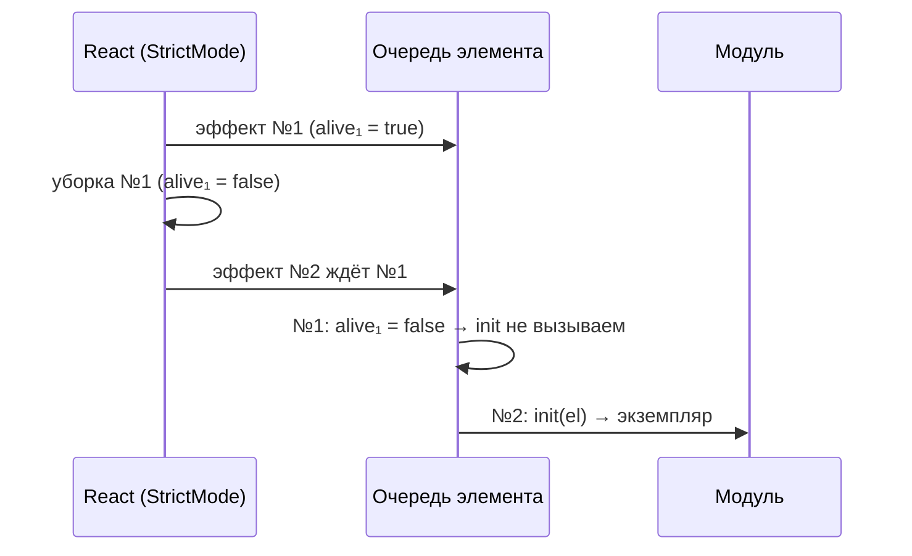

# 08. Кит в React

## Зачем

В React-проекте тоже нужны аккордеон, модалка, маска телефона, появление при прокрутке.
Можно поставить пять библиотек (у каждой свой стиль, свои баги, свой размер). А можно взять
**те же модули кита**: они уже проверены в вёрстке, у них те же стили и те же исправленные баги.

Мешает одно: модуль кита — это функция `init(element, ctx)`, а в React нет «просто элемента».
Элемент появляется после рендера, исчезает при смене страницы, а в разработке ещё и создаётся
**дважды**. Хук `useModule` берёт всё это на себя.

## Самый маленький пример

```jsx
import { useModule } from 'kit/react/index.js'
import accordion from 'kit/js/modules/accordion/index.js'

export function Faq() {
  const ref = useModule(accordion, { multiple: true }) // модуль + настройки
  return (
    <div className="accordion" ref={ref}>
      {' '}
      {/* ← на этот элемент */}
      <div className="accordion__item" data-accordion-item>
        <h3>
          <button className="accordion__trigger" data-accordion-trigger>
            Вопрос
          </button>
        </h3>
        <div className="accordion__panel" data-accordion-panel>
          <div className="accordion__inner">Ответ</div>
        </div>
      </div>
    </div>
  )
}
```

Что делает `useModule`:

1. создаёт `ref` — «ссылку на DOM-элемент»; вы вешаете её на корень разметки;
2. после рендера вызывает `accordion(элемент, ctx)`, где в `ctx.options` лежит `{ multiple: true }`;
3. когда компонент исчезает — вызывает `destroy()`.

`data-module` не нужен: модуль запускает хук, а не реестр.

## Главная мысль: кто чем управляет

Модуль меняет атрибуты: `data-open`, `aria-expanded`, `inert`, классы `is-*`. React тоже
управляет атрибутами — теми, что вы написали в JSX. Если оба управляют **одним** атрибутом,
React при следующем рендере затрёт то, что поставил модуль.

```jsx
// ✗ React перезапишет aria-expanded при каждом рендере — аккордеон «залипнет»
<button data-accordion-trigger aria-expanded={false}>…</button>

// ✓ aria-expanded ставит модуль, React его не трогает
<button data-accordion-trigger>…</button>
```

**Правило: в JSX — только то, что нужно для первого кадра. Дальше состоянием владеет модуль.**

Поэтому в стартовом [Accordion.jsx](../../starters/react/src/components/Accordion.jsx):

```jsx
// data-open задаём только при первом рендере — дальше состоянием управляет модуль.
<div data-accordion-item data-open={openFirst && i === 0 ? '' : undefined} key={item.title}>
```

## Как это сделано: `useModule` по шагам

[kit/react/useModule.js](../../kit/react/useModule.js) — около 60 строк кода. Разберём три
проблемы, которые он решает.

### Проблема 1: StrictMode запускает всё дважды

В разработке `<StrictMode>` нарочно делает **mount → unmount → mount**, чтобы ловить утечки.
Для модуля это значит: запустился, `destroy`, запустился снова. Если `destroy` убрал не всё —
второй запуск увидит мусор первого.

Так в ките нашли настоящий баг (он описан в шапке файла): модуль `select` прятал родной
`<select>` классом `select__native`. В StrictMode первый, уже **отменённый** экземпляр
запускался **после** второго (он был ленивым и грузился дольше) и в своём `destroy` снимал общий
класс. Родной `<select>` становился виден рядом с красивым.

Решение — **очередь на элемент**:

```js
const queues = new WeakMap() // элемент → обещание «предыдущий экземпляр запущен И убран»

useEffect(() => {
  const el = ref.current
  let alive = true // жив ли этот эффект (не отменён ли)
  let destroy = null

  const run = (queues.get(el) ?? Promise.resolve()) // дождаться предыдущего
    .then(() => (alive ? init(el, ctx) : null)) // отменили до запуска — не запускать вовсе
    .then((result) => {
      if (!alive) return result?.destroy?.() // отменили во время запуска — сразу убрать
      destroy = result?.destroy ?? null
      callback.current?.(result ?? null)
    })
  queues.set(el, run)

  return () => {
    // уборка эффекта
    alive = false
    destroy?.()
    callback.current?.(null)
  }
}, [init, key, kit])
```

Последовательность в StrictMode теперь всегда такая:



Модуль запускается **один** раз, и ни один «призрак» не может его испортить.

### Проблема 2: объект настроек каждый рендер новый

```jsx
const ref = useModule(slider, { autoplay: 5000 })
```

`{ autoplay: 5000 }` — новый объект при **каждом** рендере. Если положить его в зависимости
`useEffect`, слайдер перезапускался бы на каждый рендер компонента (печатаете в поле поиска —
слайдер дёргается).

Хук сравнивает настройки **по значению** — превращает их в строку-ключ:

```js
export function optionsKey(options = {}) {
  return Object.keys(options)
    .sort()
    .map((key) => {
      const value = options[key]
      if (value !== null && (typeof value === 'object' || typeof value === 'function')) {
        if (!ids.has(value)) ids.set(value, ++lastId)
        return `${key}#${ids.get(value)}` // объекты и функции — по ссылке (номер)
      }
      return `${key}=${JSON.stringify(value)}` // числа, строки — по значению
    })
    .join('&')
}
// { autoplay: 5000 }                → "autoplay=5000"   (одинаковый при каждом рендере)
// { schema: callbackSchema }        → "schema#1"
```

Числа и строки — по значению: `{ autoplay: 5000 }` каждый рендер даёт тот же ключ. А объекты и
функции — **по ссылке** (им выдаётся номер). Поэтому:

```jsx
// ✗ новая схема на каждый рендер → форма перезапускается, введённое сбрасывается
const ref = useModule(form, { schema: s.object({ … }) })

// ✓ схема объявлена ВНЕ компонента — одна и та же ссылка
const FORM_OPTIONS = { ajax: true, antispam: true, schema: callbackSchema }
export function CallbackDialog() {
  const formRef = useModule(form, FORM_OPTIONS)
```

Так и сделано в [CallbackDialog.jsx](../../starters/react/src/components/CallbackDialog.jsx).
Если объект зависит от пропсов — `useMemo`, функция — `useCallback`.

### Проблема 3: как достать API модуля

Третий аргумент — функция, которая получит экземпляр после запуска (и `null` после уборки):

```jsx
const api = useRef(null)
const ref = useModule(dialog, {}, (instance) => (api.current = instance))

<button onClick={() => api.current?.open()}>Открыть</button>
<dialog ref={ref} id="callback">…</dialog>
```

`?.` обязателен: в первый момент (и пока ленивый модуль грузится) экземпляра ещё нет.

## `KitProvider`: общий `ctx`

```jsx
// main.jsx
<StrictMode>
  <KitProvider smooth>
    <BrowserRouter>
      <App />
    </BrowserRouter>
  </KitProvider>
</StrictMode>
```

`KitProvider` даёт модулям тот же «рюкзак», что `createApp` в вёрстке: шину `bus`, `reduced`,
плавный скролл `scroll`. Без провайдера модули тоже работают — с минимальным контекстом.

Тонкость, ради которой в [provider.jsx](../../kit/react/provider.jsx) длинный комментарий:
эффекты **детей** выполняются **раньше** эффекта родителя. Значит, модули в компонентах
запустятся до того, как провайдер создаст Lenis. Если бы провайдер после этого отдал новый
объект контекста — все `useModule` перезапустились бы. Поэтому объект контекста создаётся
**один раз**, а `scroll` в нём — «живой» геттер:

```js
function createKitValue() {
  const holder = { scroll: null }
  return {
    bus: createBus(),
    reduced: prefersReducedMotion(),
    get scroll() {
      return holder.scroll
    }, // читается в момент обращения
    attachScroll(scroll) {
      holder.scroll = scroll
    },
  }
}
```

Модуль, который обращается к `ctx.scroll` при клике, получит уже готовый Lenis.

## Остальные хуки

| Хук                   | Что делает                                 | Пример                                 |
| --------------------- | ------------------------------------------ | -------------------------------------- |
| `useBus(event, fn)`   | подписка на шину; отписка сама             | `useBus('menu:toggle', setOverlay)`    |
| `useMediaQuery(q)`    | `true/false`, перерисовывает при изменении | `useMediaQuery('(min-width: 1024px)')` |
| `useBreakpoint('lg')` | то же по имени брейкпоинта из SCSS         | `const desktop = useBreakpoint('lg')`  |
| `useReducedMotion()`  | «меньше движения»                          | отключить свою анимацию                |
| `useFlip`             | анимация перестановки списка (GSAP Flip)   | фильтр карточек                        |

`useMediaQuery` построен на `useSyncExternalStore` — официальном способе React подписаться на
внешний источник (здесь — `matchMedia`). Третий аргумент — значение для сервера: в Next.js и
Astro хук не упадёт и не вызовет ошибку гидрации.

## SPA: два бага при смене страницы

В вёрстке каждая страница — новая загрузка. В SPA нет, и появляются два бага, которые стартер
лечит в `App.jsx`:

```js
function useRouteReset() {
  const { pathname, hash } = useLocation()
  const kit = useKit()
  useEffect(() => {
    if (hash) return // переход по якорю — не трогаем
    if (kit?.scroll) kit.scroll.scrollTo(0, { immediate: true })
    else window.scrollTo(0, 0) // баг 1: прокрутка осталась внизу
    requestAnimationFrame(() => ScrollTrigger.refresh()) // баг 2: позиции от старой страницы
  }, [pathname, hash, kit])
}
```

## Состав изменился — перезапустите через `key`

Модуль читает разметку **один раз** при запуске. Пришли новые слайды — модуль о них не знает.

```jsx
<Slider key={items.length}>{items.map(…)}</Slider>
```

Новый `key` — React считает это **другим** компонентом: старый размонтирует (модуль
`destroy`), новый смонтирует (модуль запустится и увидит новые слайды).

## Ошибки

> **Модуль перезапускается на каждый рендер** — в настройках объект или функция, созданные
> внутри компонента. Вынесите наружу или в `useMemo`/`useCallback`.
>
> **Аккордеон открывается и тут же закрывается / состояние «залипло»** — тот же атрибут
> задан в JSX. Уберите из JSX всё, чем управляет модуль.
>
> **`api.current.open is not a function`** — экземпляр ещё не готов. `api.current?.open()`.
>
> **В разработке модуль «работает дважды»** — его `destroy` убирает не всё. StrictMode это и
> показывает; на проде будет утечка при смене страниц.
>
> **Добавили слайд — слайдер его не видит** — `key` по составу.

## Попробуйте сами

1. Запустите `npm run dev:react`. На главной откройте и закройте модалку. Затем в коде
   `CallbackDialog.jsx` перенесите `FORM_OPTIONS` внутрь компонента. Введите имя и что-нибудь,
   что вызывает перерисовку. Что происходит с формой?
2. Чему равен `optionsKey({ b: 2, a: 'x' })`? А `optionsKey({ a: 'x', b: 2 })`?
3. Напишите компонент `<CopyButton text>` на модуле `copy` из кита (разметка — в шапке
   `kit/js/modules/copy/index.js`).
4. Зачем в `useModule` два эффекта, а не один?

<details>
<summary>Ответы</summary>

1. Пока перерисовок нет — ничего. При каждой перерисовке `CallbackDialog` объект новый →
   ключ новый → форма `destroy` и запуск заново: ошибки и статус сбрасываются. (В стартере
   `CallbackDialog` почти не перерисовывается, поэтому баг легко не заметить — тем он и опасен.)
2. Оба `"a=\"x\"&b=2"` — ключи сортируются.
3. Модуль `copy` слушает клики по кнопкам `[data-copy]` **внутри** своего элемента
   (делегирование), текст берёт из значения атрибута:
   ```jsx
   import { useModule } from 'kit/react/index.js'
   import copy from 'kit/js/modules/copy/index.js'
   export function CopyButton({ text }) {
     const ref = useModule(copy)
     return (
       <span ref={ref}>
         <button type="button" data-copy={text}>
           Скопировать
         </button>
       </span>
     )
   }
   ```
   Для одной кнопки модуль даже не обязателен: `copyText(text)` из того же файла в `onClick`.
4. Первый эффект без зависимостей на каждом рендере обновляет `callback.current` и
   `latestOptions.current` — модуль всегда видит последний колбэк, **не перезапускаясь**.
   Второй запускает модуль только при смене модуля, ключа настроек или контекста.

</details>
