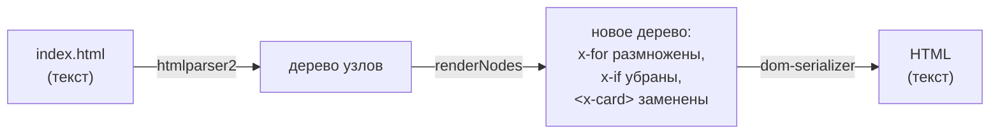

# 09. Сборка и плагины Vite — как устроена «магия»

В главе 01 `<x-card>` превращался в HTML «сам». В главе 05 на `/api/callback` отвечал «мок».
Иконки появлялись по `<x-icon name>`. Эта глава показывает, что за этим стоит: пять
небольших плагинов Vite в [kit/vite/](../../kit/vite/).

## Что такое Vite и что такое плагин

**Vite** делает две работы:

1. **`npm run dev`** — сервер разработки. Браузер просит файл — Vite отдаёт его, по дороге
   превращая SCSS в CSS, а современный JS — в понятный браузеру. Сохранили файл — страница
   обновилась.
2. **`npm run build`** — сборка. Берёт всё, сжимает, склеивает и кладёт в `dist/` — эту папку
   отдают на хостинг.

**Плагин** — объект с функциями-«крючками» (хуками), которые Vite вызывает в определённые
моменты. Минимальный плагин:

```js
export function hello() {
  return {
    name: 'hello', // имя — для сообщений об ошибках
    transformIndexHtml(html) {
      // крючок: «вот HTML страницы, верни новый»
      return html.replace('</body>', '<p>Привет от плагина</p></body>')
    },
  }
}
```

```js
// vite.config.js
export default defineConfig({ plugins: [hello()] })
```

Каждая страница теперь заканчивается абзацем «Привет от плагина». Вот и вся идея. Плагины кита
делают то же самое, только полезнее.

Крючки, которые встречаются в ките:

| Крючок                       | Когда вызывается                                        | Кто в ките использует        |
| ---------------------------- | ------------------------------------------------------- | ---------------------------- |
| `transformIndexHtml`         | Vite отдаёт/собирает HTML-страницу                      | компоненты, спрайт иконок    |
| `configureServer`            | запускается dev-сервер — можно добавить свои ответы     | мок-API, слежение за файлами |
| `config`                     | Vite читает настройки — можно дописать свои             | список страниц               |
| `generateBundle`             | сборка готова, файлы ещё не записаны                    | защита от dev-инструментов   |
| `apply: 'serve'` / `'build'` | не крючок, а фильтр: «только в dev» / «только в сборке» | мок-API, защита              |

## Все пять плагинов одним вызовом

```js
// starters/vanilla/vite.config.js
import { kit } from '../../kit/vite/index.js'
export default defineConfig({ plugins: [...kit()] })
```

```js
// kit/vite/index.js
export function kit({ include = true, icons = {}, pages = true, mocks = {} } = {}) {
  return [
    include && htmlComponents(…),     // <x-компоненты>, {{ }}, x-for/x-if
    icons !== false && svgSprite(…),  // src/icons → спрайт
    pages && pagesInput(),            // все .html — страницы сборки
    mocks !== false && mockApi(…),    // фейковый /api/*
    devtoolsGuard(),                  // сборка падает, если dev-панель попала в прод
  ].filter(Boolean)                   // выключенные (false) выбрасываем
}
```

**Порядок важен.** Компоненты стоят раньше спрайта: сначала `<x-icon name="heart" />`
превращается в `<svg><use href="#icon-heart">`, и только потом спрайт ищет в HTML `#icon-…`.
Поменяйте местами — спрайт не увидит ни одной иконки.

## Плагин 1: компоненты — `html-components.js`

Самый большой (600 строк), но идея простая.



1. **Разобрать** HTML в дерево (библиотека `htmlparser2`) — так проще, чем регулярками: видно,
   где элемент, где его атрибуты, где дети.
2. **Обойти** дерево и построить новое:
   - текстовый узел — подставить `{{ }}`;
   - элемент с `x-for` — повторить для каждого значения;
   - элемент с `x-if` — оставить или выбросить;
   - тег `<x-имя>` — прочитать `src/components/имя/имя.html`, разобрать **его** и обойти
     рекурсивно со своими props.
3. **Собрать** дерево обратно в текст.

### Как вычисляется `{{ price * 2 }}`

Самое интересное место. Выражение — это строка `"price * 2"`. Её нужно выполнить, причём
`price` должен взяться из props компонента. Кит делает так:

```js
const fn = new Function('$scope', `with ($scope) { return (${expr}) }`)
```

`new Function` создаёт функцию из строки. `with ($scope)` — старая конструкция JS: «ищи имена
сначала в этом объекте». Внутри `with` имя `price` найдётся как `$scope.price`.

А `$scope` — не обычный объект, а `Proxy` (объект-перехватчик):

```js
const proxy = new Proxy(scope, {
  has: (_, key) => typeof key === 'string' && !GLOBALS.has(key), // «да, у меня есть ЛЮБОЕ имя»
  get: (target, key) => (key in target ? target[key] : undefined), // нет такого — undefined
})
```

Зачем такие сложности? Без Proxy `{{ subtitle }}`, когда `subtitle` не передали, бросил бы
`ReferenceError: subtitle is not defined`. С Proxy `with` думает, что в объекте есть **любое**
имя, и получает `undefined`. Поэтому `x-if="subtitle"` просто ложно, а не роняет сборку.
Исключение — `GLOBALS` (`Math`, `JSON`, `Date`…): их Proxy «не знает», и они берутся настоящие.

> `with` и `new Function` в браузерном коде — плохая идея (медленно, небезопасно). Здесь они
> работают **в Node при сборке** и только с вашими шаблонами — безопасно, а скомпилированная
> функция кешируется по тексту выражения.

### Области видимости: `Object.create`

Внутри цикла `x-for="item of items"` должна быть видна и `item`, и всё внешнее (`site`, `page`).
Кит создаёт новую область **наследованием**:

```js
const itemScope = Object.create(scope) // «всё, что есть в scope, плюс…»
itemScope.item = value // «…своя item»
```

Внутри цикла `item` своя, а за `site` JS сходит по цепочке прототипов в родительскую область.
Внешняя область не меняется — у каждой итерации своя `item`.

### Ошибки с адресом

Каждая ошибка шаблона знает, **где** она:

```
[html] /index.html → x-faq → x-button: не удалось вычислить «price.toFixed()»:
Cannot read properties of undefined
```

Для этого обход носит с собой стек `c.stack = ['x-faq', 'x-button']` и дописывает его в
сообщение. Без этого ошибка в пятом по вложенности компоненте ищется вечность.

Полный разбор файла — [code/09-html-components.md](../code/09-html-components.md).

## Плагин 2: SVG-спрайт — `svg-sprite.js`

Задача: иконки из Figma лежат файлами в `src/icons/`. Как вставить их на страницу?

| Способ                                                                              | Минус                                  |
| ----------------------------------------------------------------------------------- | -------------------------------------- |
| ``                                                             | нельзя перекрасить через CSS (`color`) |
| вставить `<svg>…</svg>` целиком в каждое место                                      | 40 копий одной иконки в HTML           |
| **спрайт**: все иконки один раз в `<symbol>`, в местах — `<use href="#icon-heart">` | ✓                                      |

Плагин:

1. находит в готовом HTML все `href="#icon-…"` — **только используемые** иконки;
2. для каждой читает файл и превращает в `<symbol id="icon-heart" viewBox="…">`;
3. по дороге заменяет цвета (`fill="#000"`) на `currentColor` — иконка берёт цвет текста;
4. вставляет скрытый `<svg>` со всеми символами сразу после `<body>`.

Многоцветная иконка (логотип) — назовите файл `logo.color.svg`, её цвета не тронут.

## Плагин 3: страницы — `pages.js`

Vite по умолчанию собирает **одну** страницу — `index.html`. Для многостраничного сайта
остальные нужно перечислить в настройках. Забыли дописать `contacts.html` — в `dev` она
открывается, а в `dist/` её нет: «на проде 404».

Плагин в крючке `config` сам находит все `.html` в корне:

```js
config(config) {
  const pages = findPages(root)   // { index: '/…/index.html', 'ui-kit': '/…/ui-kit.html', … }
  return { build: { rolldownOptions: { input: pages } } }   // Vite сольёт с вашими настройками
}
```

## Плагин 4: мок-API — `mock-api.js`

Бэкенда ещё нет, а форме нужно куда-то отправлять. Плагин добавляет в dev-сервер свой
обработчик запросов (middleware):

```js
configureServer(server) {
  server.middlewares.use(async (req, res, next) => {
    if (!url.pathname.startsWith('/api/')) return next()   // не наш запрос — дальше
    // /api/callback → mocks/callback.js
    const mod = await server.ssrLoadModule(file)           // загрузить файл мока
    const handler = mod[req.method] ?? mod.default         // export function POST / GET / default
    const result = await handler({ body, query, req })
    await new Promise((r) => setTimeout(r, 400))           // имитация медленной сети
    send(status, body)
  })
}
```

Детали, которые делают его удобным:

- **путь = файл**: `/api/news/latest` → `mocks/news/latest.js`;
- **экспорт по методу**: `export function POST`, `export const GET`;
- **ответ**: `{ status, body }` или просто данные (тогда 200); строка уходит как HTML — для
  «Показать ещё», которое ждёт кусок разметки;
- **задержка 400 мс** — на мгновенном локальном сервере не видно спиннеров и не ловятся двойные
  клики. С задержкой — видно;
- **`ssrLoadModule`** перечитывает файл после правки — перезапускать сервер не нужно;
- **`apply: 'serve'`** — в сборку плагин не попадает вовсе. На проде запросы уходят на
  настоящий бэкенд.

## Плагин 5: защита прода — `devtools-guard.js`

Dev-панель (сетка, FPS, проверка доступности) подключается так:

```js
if (import.meta.env.DEV) {
  import('kit/devtools/index.js').then((m) => m.installDevtools())
}
```

При сборке Vite заменяет `import.meta.env.DEV` на `false`. Получается `if (false) { … }` —
сборщик видит, что код недостижим, и **выбрасывает** его вместе с импортом.

Но стоит написать чуть иначе:

```js
const isDev = import.meta.env.DEV && location.hostname === 'localhost'
if (isDev) import('kit/devtools/index.js')
```

— и сборщик уже не может доказать, что условие ложно (`location` известен только в браузере).
Dev-панель уезжает к заказчику.

Защита: в файле dev-панели есть уникальная метка `__KIT_DEVTOOLS__`. Плагин в крючке
`generateBundle` (сборка готова, файлы ещё не записаны) ищет её во всех файлах:

```js
generateBundle(_, bundle) {
  const leaked = Object.values(bundle).filter((file) => file.code?.includes('__KIT_DEVTOOLS__'))
  if (leaked.length) this.error('Dev-инструменты попали в продакшн-сборку…')
}
```

`this.error` останавливает сборку с объяснением. Ошибку видно сразу, а не после жалобы
заказчика.

## Сайт в подпапке: `BASE_URL`

GitHub Pages отдаёт сайт по адресу `user.github.io/my-site/`, а не с корня. Все пути
`/assets/main.js` превратятся в 404. Решение — собрать с базовым путём:

```bash
BASE_URL=/my-site/ npm run build
```

В `vite.config.js`: `base: process.env.BASE_URL ?? '/'`. В HTML ссылки пишутся как
`%BASE_URL%about.html` — Vite подставит базовый путь.

## Ошибки

> **Иконка не появилась** — в консоли сборки `[svg-sprite] нет иконки «hart». Есть: heart, …`.
> Или у SVG нет `viewBox` — тогда ошибка «иконка не будет масштабироваться».
>
> **Новая страница есть в dev, нет в `dist/`** — она лежит не в корне (во вложенной папке).
> `pagesInput({ nested: true })`.
>
> **`[mock-api] нет файла mocks/callback.js`** — мок не создан или путь не совпадает с адресом.
>
> **«Dev-инструменты попали в продакшн-сборку»** — импорт dev-панели без условия
> `if (import.meta.env.DEV)` прямо в `if`.
>
> **На GitHub Pages белая страница** — собрали без `BASE_URL`.

## Попробуйте сами

1. Напишите плагин, который добавляет в `<head>` каждой страницы
   `<meta name="generator" content="frontend-kit">`. Какой крючок?
2. Создайте `mocks/time.js`, который на `GET /api/time` отвечает текущим временем. Как
   проверить без формы?
3. Почему `{{ Math.round(4.6) }}` работает, хотя `Math` никто не передавал в props?
4. Добавьте в `src/icons/` иконку, но не используйте её ни на одной странице. Попадёт ли она в
   HTML? А если её вставляет JS?

<details>
<summary>Ответы</summary>

1. `transformIndexHtml`:
   ```js
   const generator = () => ({
     name: 'generator',
     transformIndexHtml: (html) => html.replace('</head>', '<meta name="generator" content="frontend-kit"></head>'),
   })
   ```
2. ```js
   export const GET = () => ({ time: new Date().toISOString() })
   ```
   Откройте `http://localhost:5173/api/time` в браузере — ответ придёт через 400 мс.
3. `Math` в списке `GLOBALS`: Proxy говорит «у меня его нет», и `with` берёт настоящий глобальный `Math`.
4. Нет — в спрайт идут только иконки с `href="#icon-…"` в разметке. Иконки, которые вставляет
   JS, перечислите в опции `always`: `svgSprite({ always: ['close'] })`.

</details>
